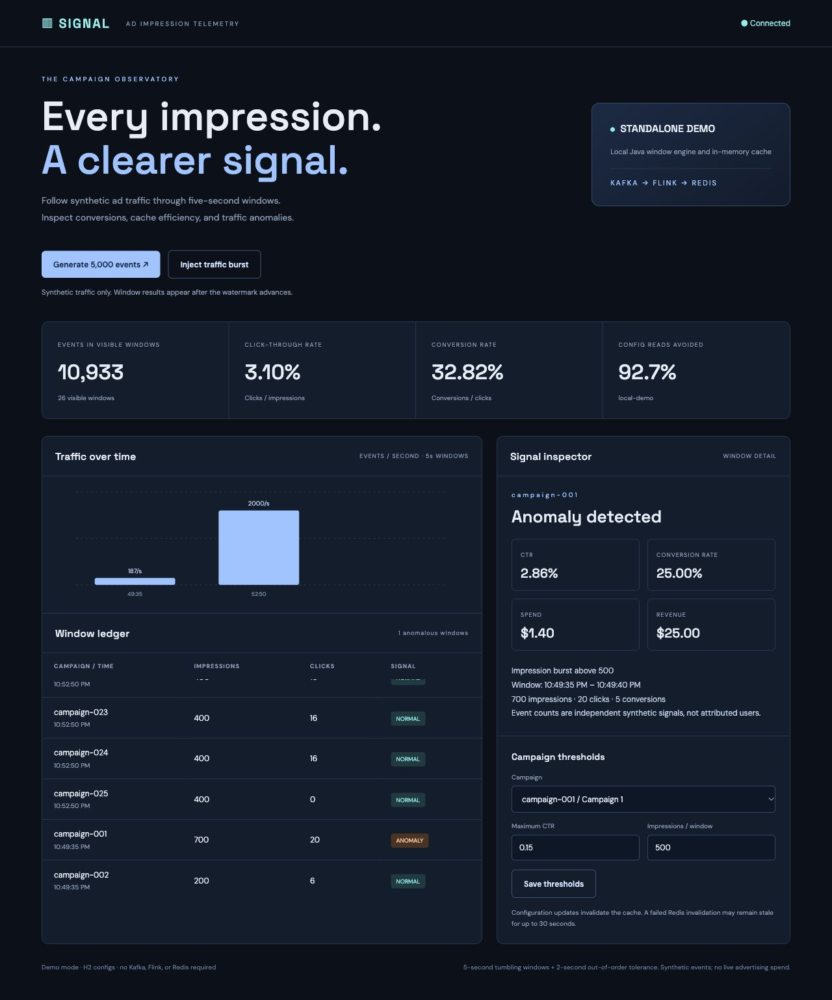

# Real-Time Ad Impression Telemetry

A reproducible Java streaming lab: HTTP ingestion → Kafka → Apache Flink five-second event-time windows → Redis projection and dashboard. Campaign configuration is stored in PostgreSQL and cached in Redis.

All impressions, clicks, and conversions are **synthetic**. The standalone demo uses a Java window engine and in-memory cache; it does not run Kafka, Flink, or Redis. Benchmark reports state which mode was actually measured.

## Full pipeline

Install Docker with Compose, then run:

```sh
docker compose up --build -d
# Dashboard: http://localhost:8090
# Flink UI:  http://localhost:8091
python3 scripts/smoke.py --expect-mode kafka
python3 scripts/kafka_checks.py
python3 scripts/load.py --count 1000000 --output benchmark-kafka.json
```

The stack has one Kafka broker, a Flink JobManager/TaskManager pair, Redis with AOF, PostgreSQL, an ingestion service, and an Nginx gateway. It is a local lab, not a highly available Kafka/Flink cluster. Named volumes retain data after `docker compose down`; adding `-v` deletes them.

After the initial configuration seed finishes, replicate ingestion nodes with:

```sh
docker compose up -d --scale ingest=2 ingest
```

Nginx resolves container addresses and distributes requests. Shared configuration/cache/projections are visible to both nodes. `acceptedByNode` is explicitly per process; cache counters use Redis across nodes while it is available.

## Standalone demo

Install JDK 17+ and use the Maven wrapper:

```sh
./mvnw verify
java -jar ingestion/target/telemetry-ingestion-1.0.0.jar
python3 scripts/smoke.py --expect-mode demo
python3 scripts/load.py --count 10000 --output benchmark-demo.json
```

The default port is 8090, so it can run beside the CRM project on 8080. Configuration persists in `data/configs`; demo window results are in memory and disappear after restart.

## Dashboard



Generate sample events or inject a campaign-001 traffic burst. Select a closed window to inspect CTR, conversion rate, spend/revenue, and anomaly reasons. Modify a campaign's thresholds to invalidate its cached configuration. Previously closed windows retain their original results.

Cards/chart summarize **visible retained windows**, not lifetime counters. Each window is five seconds long; results appear after the watermark passes its end, with two seconds of out-of-order tolerance and normal processing/polling overhead. A five-second window is not a guarantee that every anomaly is displayed within five wall-clock seconds.

## Data and calculations

An event has `eventId`, `campaignId`, `type`, `eventTimeMs`, and `amount`. Types are IMPRESSION, CLICK, or CONVERSION; impression amount means synthetic spend, conversion amount means synthetic revenue. Click amount is zero. Counts are independent synthetic event signals; conversions are not joined to particular impression/click/user identities.

- CTR = clicks / impressions; conversion rate = conversions / clicks.
- ROAS = revenue / spend. A zero denominator returns zero.
- A volume anomaly exceeds the campaign's maximum impressions per window.
- A CTR anomaly requires at least 100 impressions and CTR above the configured maximum.

Twenty-five campaigns are seeded. Campaign-001's default volume threshold is 500; the others use 5,000. Configuration TTL is 30 seconds. Cache avoidance is measured against configuration **lookups**, not every event; each HTTP batch checks distinct campaigns once.

## Delivery, windows, and recovery

The API validates a complete batch before publishing and returns 202 after Kafka acknowledgements. The producer enables idempotence and `acks=all`. These settings do **not** deduplicate HTTP retries. A failed batch can already have acknowledged a subset, and a caller retry can duplicate events. Duplicate event IDs within one batch are rejected; there is no global event-ID deduplication.

Flink checkpoints source offsets and window state every five seconds. Raw input uses six partitions; internal heartbeat records are sent to every partition so idle traffic still closes windows. Heartbeats advance time and are filtered out of metrics. Invalid Kafka JSON and records arriving after their window has closed go to `ad.dead-letter`.

`ad.windows` uses at-least-once output. Redis receives full window snapshots keyed by campaign ID + window start, atomically overwriting the same key on replay. This prevents duplicated projection rows, but is not an atomic transaction across Kafka and Redis. AOF/checkpoint volumes must be retained. Flink task failures can recover from the live job's checkpoints; restarting an entire standalone JobManager does not automatically restore a prior checkpoint in this lab.

## APIs

| Endpoint | Purpose |
| --- | --- |
| `POST /api/events` | Accept 1–2,000 validated events |
| `GET /api/configs` | List campaign configurations |
| `GET /api/configs/{id}` | Cache-aside lookup |
| `PUT /api/configs/{id}` | Update thresholds and invalidate cache |
| `GET /api/windows?limit=120` | Inspect up to 2,000 retained windows |
| `GET /api/stats` | Mode, node ID, per-node accepted count, cache counters |
| `GET /actuator/health/readiness` | API readiness |

```json
[{"eventId":"demo-1","campaignId":"campaign-002","type":"IMPRESSION","eventTimeMs":1791500000000,"amount":0.002}]
```

Replace the timestamp with the current Unix time in milliseconds when submitting. The HTTP validator allows 24 hours of lookback and 2 seconds of future skew. Old valid HTTP events can still be too late for Flink and go to the dead-letter topic.

## Verification

`mvn verify` exercises validation, exact counts/rates, anomaly rules, cache hits/invalidation, window boundaries/late events, projection overwrite, and Flink POJO serializers. Docker CI additionally tests the actual Kafka/Flink/Redis stack, dead letters, checkpoints, one million events, and two ingestion instances.

The CI workflow is a check definition; see [verification](docs/VERIFICATION.md) and reports for observed results. The benchmark requires an isolated stack and verifies every submitted event against its closed window. Runs exceeding the 2,000 retained-window cap must be shortened or use a separate sink.

No 85% database-read reduction or sub-20ms latency is assumed. Cache counters and client latency measurements provide evidence for a particular workload. See [architecture](docs/ARCHITECTURE.md) and [demo walkthrough](docs/WALKTHROUGH.md).

## Configuration

`PIPELINE_MODE=demo|kafka`, `PORT=8090`, `SERVER_ADDRESS=127.0.0.1`, `KAFKA_BOOTSTRAP_SERVERS`, `REDIS_HOST`, `REDIS_PORT`, `DATABASE_URL`, `DATABASE_USER`, `DATABASE_PASSWORD`. Compose sets internal addresses and binds only dashboard/Flink ports to loopback.

This unauthenticated lab should remain local. A production system would need authorization, schema compatibility management, global deduplication, user attribution, metrics export, backpressure-aware rate limits, retention policies, and a replicated broker/processing cluster.

MIT licensed.
