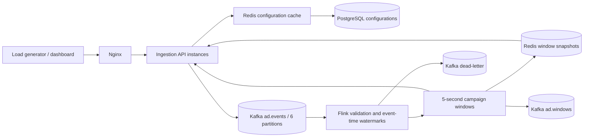

# Architecture

## Modules

- `common`: Java POJO event/accumulator/report types, validation, calculations, JSON.
- `ingestion`: Spring Boot HTTP API, configuration cache, database, Kafka producer, dashboard; explicit standalone demo engine.
- `stream-job`: Flink source, parser, watermarks, incremental aggregation, configuration lookup, Kafka output and Redis sink.

Incremental aggregation retains counters per campaign/window instead of buffering every event. Two-second bounded out-of-order watermarks make the latency/completeness tradeoff explicit. Producer heartbeat records reach every input partition, and a three-second idleness setting prevents an inactive subtask from blocking watermark progress.

Campaign configuration is looked up through the ingestion API when a window closes. A cache-aside read consults Redis before PostgreSQL. Updates commit the database first and then invalidate the cache; invalidation failures are bounded by TTL but do not provide strong consistency. A historical window replay can see newer anomaly thresholds. Counts still reflect the replayed window's events.

Redis snapshots use a Lua HSET/ZADD upsert with a fixed identity and retain the newest 2,000 windows. Replaying one completed snapshot overwrites the row instead of incrementing counters. The sink remains at-least-once; it does not share a transaction with Kafka or Flink state.

## Limits

No global event-ID deduplication, click-to-conversion attribution, production SLA, or whole-cluster HA is claimed. Consumer offsets/window state are checkpointed; completed snapshots are external side effects. Default standalone JobManager restarts require an explicit savepoint/checkpoint restoration strategy for continuation rather than replaying earliest retained input. Late or malformed records are inspectable in the dead-letter topic.

Configuration cache counters count lookups, including window enrichment, not one query per event. Redis failures use node-local counters and fall back to database configuration reads. The dashboard clearly labels this scope.
